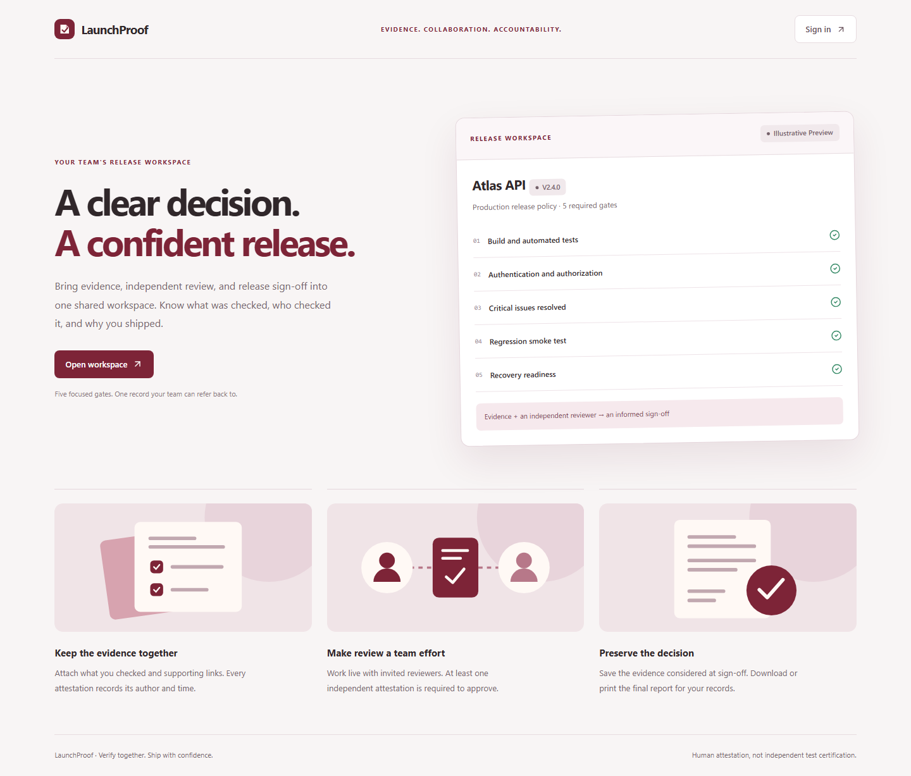

# LaunchProof

**Verify together. Ship with confidence.**

A collaborative release sign-off workspace for evidence, independent review, and saved decisions. Built with React, TypeScript, and DeepSpace authentication, records, live subscriptions, and server actions.

[Open the app](https://launchproof-sabin901.app.space) · [Development guide](docs/DEVELOPMENT.md) · [Submission writeup](docs/SUBMISSION.md)



## Use the app


1. Open the workspace and sign in with DeepSpace.
2. Create a release with a product name and version. Five production-release gates are created: build/tests, authentication, critical issues, regression smoke, and recovery.
3. Ask a colleague to sign in once and copy their reviewer ID from Releases. The release lead adds that ID to the team.
4. Record what was checked, an optional HTTP(S) evidence URL, and a verified/failed attestation. Each saved change carries the authenticated actor and server time; teammates receive live updates.
5. Approval requires all five gates with qualifying evidence, **at least one gate verified by a different active reviewer**, and an authorized lead. A lead may instead reject with a reason.
6. After a decision, evidence is read-only. The decision report renders the saved snapshot, including independent reviewer identities, even after refreshing.

## Local development


Use Node 24 and npm 11.6+. Verified environment: Node 24.14.1, npm 11.13.0. Lockfile pins transitive dependencies.

```sh
npm ci
npx deepspace auth login
npx deepspace auth whoami --json
npx deepspace dev start
npm run type-check
npm run lint
npm run test:unit
npx deepspace test run e2e --port 5181
npm run build
```

Three usable DeepSpace test accounts are needed for all tests. Inspect `npx deepspace test accounts list --usable`, then create only missing accounts using `--password-stdin`. Credentials stay in the SDK's local credential store, never in the repository. The SDK fixture creates separate signed-in browser contexts and uses real auth and records. Tests create fictional `__test-*` releases under their own accounts; these records are retained because the application deliberately has no deletion or test-bypass endpoint.

To test an existing deployment without starting a local server, set `LAUNCHPROOF_BASE_URL` to its HTTPS origin and run `npx playwright test --config tests/playwright.config.ts`. Do not point this at an unrelated app.

## Scope and tradeoffs

The policy has five fixed gates. Evidence is human-attested: LaunchProof does not run CI, certify supporting links, or deploy your software. Final decisions preserve the evidence snapshot and prevent further application edits.

There are no external integrations, evidence revision history, deletion, membership removal, or interrupted-setup repair UI. Serialized actions prevent concurrent decision races but are not multi-record rollback transactions. See the [development guide](docs/DEVELOPMENT.md) for security boundaries, operational limitations, and a personal walkthrough.

## Deployment and provenance

GitHub is this app's permanent source. Commit and push to `main`, then deploy the clean checkout with `npx deepspace deploy`. Do not use `deepspace push`. Keep credentials, `.dev.vars`, logs, and test artifacts out of Git.

Codex implemented and checked the code under the applicant's direction. Automated checks cover TypeScript, lint, 13 unit tests, and 21 browser tests using real authentication and records. Agent-run tests do not replace the applicant's personal walkthrough. Original logo and illustrations live in `public/` and require no external services.
